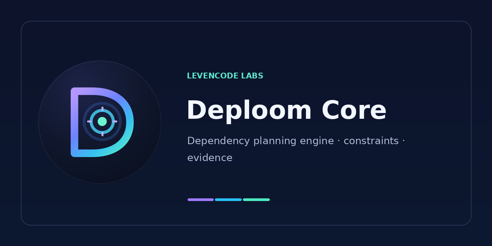

<div align="center">



# Deploom Core

**Dependency planning with explicit constraints and evidence.**

[Levencode Labs](https://github.com/levencode-labs) · [Deploom MCP](https://github.com/levencode-labs/deploom-mcp) · [Releases](https://github.com/levencode-labs/deploom-core/releases)

</div>

Deploom Core is a headless Python engine for planning dependency upgrades in JavaScript/TypeScript projects. It models candidate versions and compatibility requirements, records which declarations the user has authorized to change, and reports what is known, blocked, or still unverified.

**Core creates plans. It does not automatically prove that an npm installation, an application's tests, or runtime behavior will succeed.**

## What it does

- Proposes version candidates within selected scope and approved version lines.
- Uses a Z3-backed model for declared compatibility/peer constraints and finite joint choices where supported.
- Distinguishes minimum changes needed for a health objective from newer choices within approved lines.
- Preserves `pinned` versus `advisory` target authority, unchanged declarations, blockers, deferred work, and missing evidence.
- Tracks source/workspace coverage and input identities so stale or partial plans remain visible.
- Supports constrained npm workspace scenarios, but does **not** claim arbitrary monorepo, lockfile, or runtime correctness from a static assignment.

A Draft proposal is **`PLANNING_ONLY` / `NOT_VERIFIED`**. An accepted lockfile, a clean install, effective dependency providers, project checks, and runtime acceptance are separate results.

## Where it fits

```text
Developer / coding agent
        │
        ▼
  Deploom MCP
        │  structured request / Blueprint
        ▼
  Deploom Core
        │  versions, constraints, evidence
        ▼
  Proposed plan  →  independent npm + project verification
```

[Deploom MCP](https://github.com/levencode-labs/deploom-mcp) is the user-facing agent integration and includes a pinned copy of Core in its published wheel. You do not need to install Core separately to run that wheel.

## Local development

Supported Core Python range: **3.12–3.13** (`>=3.12,<3.14`). From a clean checkout:

```sh
python -m venv .venv
python -m pip install -e .
python dependency_live_roadmap_generator.py --help
python -m unittest discover -s tests -p 'test_required_planner.py' -v
```

Use the interpreter from your virtual environment if `python` resolves elsewhere. The [CI workflow](.github/workflows/ci.yml) and [testing notes](docs/TESTING.md) describe which tests are covered; a green lightweight suite is not a full migration acceptance.

## Documentation

- [MCP integration and pinned Core](docs/INTEGRATION.md)
- [Testing boundary](docs/TESTING.md)
- [Release process](docs/RELEASING.md)
- [Architecture/extraction background](docs/EXTRACTION_STATUS.md)
- [Historical experiments and limitations](docs/AB_NO_SKILL_PROTOCOL.md)

## Repository family

| Repository | Purpose |
| :-- | :-- |
| **[deploom-core](https://github.com/levencode-labs/deploom-core)** | Core decision and planning engine |
| **[deploom-mcp](https://github.com/levencode-labs/deploom-mcp)** | MCP tools, Blueprint adapter, agent Skill, and authorized evidence workflows |

**Release status:** the most recently verified public Core release when this README was prepared (2026-11-08) was [`v0.1.7`](https://github.com/levencode-labs/deploom-core/releases/tag/v0.1.7). For newer releases use the [Releases page](https://github.com/levencode-labs/deploom-core/releases/latest). Do not equate published binaries with acceptance on your own project.
